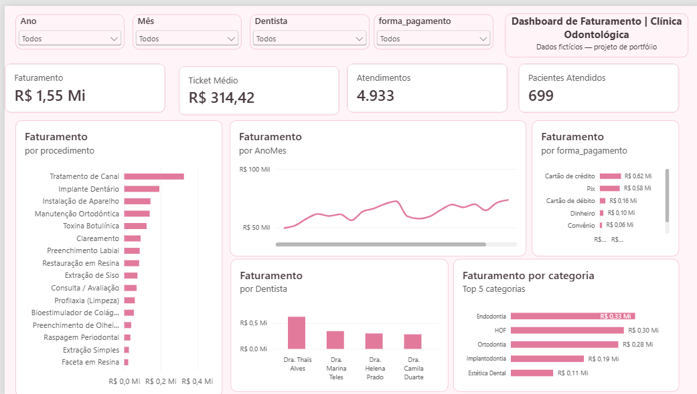

# Dashboard de Faturamento — Clínica Odontológica (Power BI)

Projeto de portfólio de análise de dados: um dashboard em Power BI alimentado por uma planilha Excel, com dados **fictícios** inspirados na rotina de uma clínica odontológica com Harmonização Orofacial (HOF) em São Gonçalo – RJ.

> **Sobre os dados:** todos os dados (pacientes, atendimentos, valores e nomes das dentistas parceiras) são fictícios, gerados por script em Python. Nenhuma informação real de pacientes ou de clínicas foi usada.

## Objetivo

Responder perguntas de gestão de uma clínica:
- Quanto a clínica fatura por mês e como isso evolui?
- Quais procedimentos e especialidades mais contribuem para a receita?
- Qual o ticket médio e como os pacientes pagam?
- Como a receita se distribui entre as profissionais?

## Ferramentas

- **Excel** (fonte de dados, em Tabelas: `tbAtendimentos`, `tbDentistas`, `tbProcedimentos`)
- **Power Query** (limpeza e tratamento)
- **Power BI Desktop** (modelagem, DAX e visualização)
- **Python (pandas)** para gerar a base fictícia — script em `gerar_dados_projeto1.py`

## Processo

1. **Geração dos dados:** 24 meses (2024–2025), com sazonalidade e crescimento ao longo do período. A base inclui "sujeira" proposital para treinar o tratamento: valores nulos na forma de pagamento, linhas duplicadas e grafias diferentes ("PIX ", "cartao credito").
2. **Limpeza no Power Query:** remoção de duplicatas (4.948 → 4.933 linhas), remoção de espaços, padronização de textos, substituição de nulos por "Não informado", renomeação da categoria "Estética" para "Estética Dental" e ajuste dos tipos de dados.
3. **Modelagem:** esquema estrela, com a tabela fato `tbAtendimentos` e as dimensões `tbDentistas`, `tbProcedimentos` e `Calendario` (tabela de datas criada em DAX).
4. **Medidas DAX:** Faturamento, Ticket Médio, Atendimentos e Pacientes Atendidos.
5. **Visualização:** 4 cartões de KPI, 5 gráficos e 4 filtros (ano, mês, dentista e forma de pagamento), com tema em tons de rosa.

## Principais números

| Indicador | Valor |
|---|---|
| Faturamento total (2024–2025) | R$ 1,55 milhão |
| Atendimentos | 4.933 |
| Ticket médio | R$ 314,42 |
| Pacientes atendidos | 699 |

## Insights

- **Crescimento anual:** o faturamento de 2025 (R$ 821,5 mil) foi cerca de **12,6% maior** que o de 2024 (R$ 729,5 mil).
- **Sazonalidade:** o melhor mês foi novembro de 2025 (R$ 80,9 mil) e o pior foi janeiro de 2024 (R$ 49,4 mil). Há queda em dezembro e em janeiro, o que sugere planejar ações de captação nesses meses.
- **Receita concentrada em poucos procedimentos:** Tratamento de Canal (21,1%), Implante Dentário (12,4%) e Instalação de Aparelho (9,3%) respondem por cerca de 43% do faturamento.
- **Especialidades:** Endodontia (21,1%), HOF (19,2%) e Ortodontia (18,3%) são as maiores fontes de receita.
- **Formas de pagamento:** cartão de crédito (40%) e Pix (37,6%) somam quase 78% da receita, o que reforça a importância de oferecer parcelamento.
- **Descontos:** cerca de 20% dos atendimentos receberam algum desconto, com média de 1,4% sobre o total.

## Arquivos

- `Projeto1_Faturamento_Clinica.pbix`: dashboard
- `Clinica_Sorriso_Pleno_Atendimentos.xlsx`: base de dados fictícia
- `gerar_dados_projeto1.py`: script que gera os dados
- `dashboard.pdf` / `dashboard.png`: exportação do dashboard

## Autora

**Thaïs Alves** — cirurgiã-dentista em transição de carreira para Análise de Dados.

[LinkedIn](https://www.linkedin.com/in/tha%C3%AFs-alves-253155203) · [GitHub](https://github.com/thataallves)
